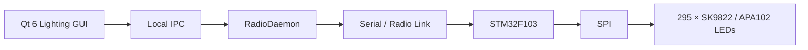

<table align="right">
  <tr>
    <td><b>🇬🇧 English</b></td>
    <td><a href="./README_RU.md">🇷🇺 Русский</a></td>
  </tr>
</table>

# 💡 Room Lighting Control System

A remotely controlled room lighting system built around an **STM32F103** and a **295-pixel SK9822 / APA102-compatible LED strip**.

The system consists of:

- STM32 firmware controlling the LED strip over SPI;
- a custom binary radio protocol with CRC16;
- a Qt 6 desktop control application;
- a separate `RadioDaemon` responsible for serial communication, queuing and reconnect logic;
- configurable lighting effects and per-pixel scenes.

The project is designed as part of a larger room-control infrastructure rather than as a standalone RGB controller.

---

## ⚙️ System Architecture



The desktop application does not access the serial port directly.

Instead, it sends commands to a dedicated background daemon over a local socket.

This separates:

```text
UI logic
    ↓
transport / queue management
    ↓
embedded device
```

and allows several applications to share the same physical communication link.

---

## 🔧 Embedded Controller

The lighting controller is based on **STM32F103**.

Main tasks:

- receive and parse commands;
- validate packet CRC;
- control LED state;
- generate animation effects;
- transfer LED frames over SPI.

The firmware uses the custom [HAL](https://github.com/suneids/HAL) register-level STM32 library.

Main peripherals:

- USART;
- SPI;
- SysTick;
- GPIO.

---

## 🌈 LED Strip

The current configuration contains:

```text
LED_COUNT = 295
```

pixels.

The strip is controlled through **SPI1**.

Each frame contains:

```text
Start frame
    ↓
295 × LED frames
    ↓
Reset / end clocks
```

Each LED frame includes:

- global brightness;
- blue;
- green;
- red.

The driver provides:

```c
LED_STRIP_SetPixel(...);
LED_STRIP_Fill(...);
LED_STRIP_Gradient(...);
LED_STRIP_SetBrightness(...);
LED_STRIP_Show();
```

Global LED brightness uses the native 5-bit brightness field of the SK9822 / APA102 protocol:

```text
0 ... 31
```

---

## 🎨 Lighting Modes

The firmware currently supports several runtime modes.

### Off

Turns the complete strip off.

### Fill

Sets the entire strip to one color.

```text
RGB + global brightness
```

### Breathe

Smoothly changes the intensity of the selected color over a configurable period.

The animation runs non-blocking from `LED_Task()` using the system millisecond timer.

### Running Dot

Moves one illuminated pixel along the strip with a short fading tail.

The update interval controls movement speed.

### Scene

Allows arbitrary pixels and sections of the strip to be configured independently.

---

## 🧩 Scene System

The scene system is one of the main features of the project.

A scene can contain:

- a global background;
- colored segments;
- individual colored pixels;
- global brightness.

Example:

```text
LED 0 ... 49      → cyan
LED 50 ... 120    → purple
LED 121 ... 200   → dark blue
LED 230           → red
LED 250           → white
```

The desktop application converts this representation into a sequence of commands:

```text
SCENE_BEGIN
      ↓
PIXEL_SET
PIXEL_SET
PIXEL_SET
...
      ↓
SCENE_SHOW
```

Segments are expanded into their individual pixels before transmission.

Individual points are applied after segments, so they can override the segment color.

The STM32 updates its internal LED buffer and only displays the complete scene when `SCENE_SHOW` is received.

This prevents partially transferred scenes from appearing on the strip.

---

## 🖥 Qt Desktop Application

The lighting controller UI is written in **Qt 6 / C++**.

It provides:

- color picker;
- global brightness control;
- individual RGB scaling;
- effect selection;
- animation period;
- running-dot speed;
- predefined presets;
- arbitrary scene construction;
- individual pixel elements;
- LED segment elements.

Current presets include:

- **Work**
- **Night**
- **Cyberpunk**
- **Test**

---

## 📡 Communication Protocol

The STM32 and desktop software use the same framed binary protocol.

Packet structure:

```text
AA 55 | Device ID | Command | Length | Payload | CRC16
```

| Field | Size | Description |
|---|---:|---|
| SOF | 2 bytes | `0xAA 0x55` |
| Device ID | 1 byte | Destination device |
| Command | 1 byte | Operation |
| Length | 1 byte | Payload size |
| Payload | 0...128 bytes | Command data |
| CRC16 | 2 bytes | Frame integrity |

CRC is calculated over:

```text
Device ID + Command + Length + Payload
```

The protocol supports both a specific device ID and broadcast commands.

The lighting controller uses:

```text
DEV_LIGHT = 0x01
```

---

## 💡 Lighting Commands

| Command | ID | Function |
|---|---:|---|
| `CMD_LED_OFF` | `0x10` | Turn strip off |
| `CMD_LED_FILL` | `0x11` | Solid color |
| `CMD_LED_BREATHE` | `0x12` | Breathing effect |
| `CMD_LED_DOT` | `0x13` | Running dot |
| `CMD_LED_SCENE_BEGIN` | `0x14` | Start scene update |
| `CMD_LED_PIXEL_SET` | `0x15` | Change one pixel |
| `CMD_LED_SCENE_SHOW` | `0x16` | Display completed scene |

The firmware uses a byte-by-byte state-machine parser, so packet reception does not depend on serial reads aligning with complete frames.

---

## 📻 RadioDaemon

Serial/radio access is handled by a separate Qt service.

`RadioDaemon` owns the physical serial port and exposes a local IPC interface to GUI applications.

It provides:

- serial connection management;
- automatic reconnect;
- outgoing packet queue;
- request / response timeout handling;
- delayed transmission;
- removal of obsolete poll requests;
- `sendLatest` semantics for rapidly changing state;
- scene packet sequencing;
- received packet validation;
- broadcasting received packets to connected clients.

Architecture:

```text
Qt application
     ↓
JSON over QLocalSocket
     ↓
RadioDaemon
     ↓
QSerialPort
     ↓
Radio network
```

When the serial device disappears, the daemon clears stale queued commands and automatically attempts reconnection.

---

## 🔄 Scene Transmission

Scenes may consist of hundreds of packets.

Instead of sending all commands directly from the GUI, the GUI passes the complete packet list to `RadioDaemon`.

The daemon then transmits them sequentially with a controlled delay:

```text
Scene packet 1
      ↓
delay
      ↓
Scene packet 2
      ↓
delay
      ↓
...
      ↓
SCENE_SHOW
```

After the final packet, the daemon reports:

```text
sceneFinished
```

back to the GUI.

This keeps serial pacing outside of the UI thread.

---

## 🖥 Desktop Integration

The lighting application can also connect to a local application aggregator.

Through this IPC connection it can receive commands such as:

```text
show
hide
```

This allows the lighting interface to operate as one module of a larger desktop control environment.

---

## 📁 Repository Structure

```text
Light/
├── app/
│   ├── firmware/
│   │   └── STM32F103 lighting controller
│   │
│   └── desktop/
│       ├── Lightning/
│       │   └── Qt lighting GUI
│       │
│       └── RadioDaemon/
│           └── shared serial/radio transport service
│
├── README.md
└── README_RU.md
```

---

## ✅ Implemented

- [x] STM32F103 lighting controller
- [x] 295-addressable-LED support
- [x] SPI LED transport
- [x] Global 5-bit brightness control
- [x] Solid-color mode
- [x] Breathing effect
- [x] Running-dot effect
- [x] Per-pixel control
- [x] Arbitrary multi-segment scenes
- [x] Binary framed protocol
- [x] CRC16 validation
- [x] Device addressing and broadcast
- [x] Qt 6 desktop controller
- [x] Lighting presets
- [x] Scene editor
- [x] Dedicated RadioDaemon
- [x] Serial reconnect logic
- [x] Radio transmission queue
- [x] Scene transmission sequencing
- [x] Local IPC integration
