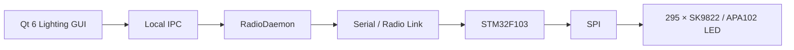

<table align="right">
  <tr>
    <td><a href="./README.md">🇬🇧 English</a></td>
    <td><b>🇷🇺 Русский</b></td>
  </tr>
</table>

# 💡 Система управления освещением комнаты

Система удалённого управления освещением на базе **STM32F103** и адресной ленты из **295 светодиодов SK9822 / APA102-compatible**.

Система состоит из:

- прошивки STM32, управляющей лентой через SPI;
- собственного бинарного протокола с CRC16;
- desktop-приложения на Qt 6;
- отдельного `RadioDaemon`, отвечающего за последовательный порт, очередь команд и восстановление связи;
- набора световых эффектов и произвольных покадровых сцен.

Проект используется как часть более крупной инфраструктуры управления комнатой, а не только как автономный RGB-контроллер.

---

## ⚙️ Архитектура системы



Desktop-приложение не работает с последовательным портом напрямую.

Вместо этого оно отправляет команды отдельному фоновому daemon через local socket.

Таким образом разделены:

```text
логика интерфейса
      ↓
transport / очередь
      ↓
embedded-устройство
```

и несколько приложений могут использовать один физический канал связи.

---

## 🔧 Embedded-контроллер

Контроллер освещения построен на **STM32F103**.

Основные задачи прошивки:

- принимать команды;
- разбирать пакеты;
- проверять CRC;
- управлять состоянием ленты;
- выполнять световые эффекты;
- передавать LED-кадры через SPI.

Прошивка использует собственную register-level библиотеку [HAL](https://github.com/suneids/HAL).

Основная периферия:

- USART;
- SPI;
- SysTick;
- GPIO.

---

## 🌈 LED-лента

Текущая конфигурация:

```text
LED_COUNT = 295
```

светодиодов.

Лента управляется через **SPI1**.

Каждый передаваемый кадр состоит из:

```text
Start frame
    ↓
295 × LED frame
    ↓
Reset / end clocks
```

Для каждого светодиода передаются:

- глобальная яркость;
- Blue;
- Green;
- Red.

Драйвер предоставляет:

```c
LED_STRIP_SetPixel(...);
LED_STRIP_Fill(...);
LED_STRIP_Gradient(...);
LED_STRIP_SetBrightness(...);
LED_STRIP_Show();
```

Для общей яркости используется встроенное 5-битное поле протокола SK9822 / APA102:

```text
0 ... 31
```

---

## 🎨 Режимы освещения

### Off

Полностью выключает ленту.

### Fill

Заполняет всю ленту одним цветом.

```text
RGB + общая яркость
```

### Breathe

Плавно изменяет яркость выбранного цвета с заданным периодом.

Эффект работает неблокирующе через `LED_Task()` и системный миллисекундный таймер.

### Running Dot

Перемещает один светящийся пиксель вдоль ленты.

Позади основной точки формируется короткий затухающий хвост.

Скорость задаётся интервалом обновления.

### Scene

Позволяет независимо задавать цвета отдельных участков и отдельных светодиодов.

---

## 🧩 Система сцен

Сцена может содержать:

- общий фон;
- цветные сегменты;
- отдельные цветные точки;
- глобальную яркость.

Например:

```text
LED 0 ... 49      → cyan
LED 50 ... 120    → purple
LED 121 ... 200   → dark blue
LED 230           → red
LED 250           → white
```

Desktop-приложение преобразует сцену в последовательность команд:

```text
SCENE_BEGIN
      ↓
PIXEL_SET
PIXEL_SET
PIXEL_SET
...
      ↓
SCENE_SHOW
```

Сегменты разворачиваются в отдельные команды для каждого пикселя.

Отдельные точки передаются после сегментов, поэтому могут перекрывать их цвет.

STM32 сначала формирует новое состояние во внутреннем LED-buffer и только после команды `SCENE_SHOW` выводит готовый кадр на ленту.

Таким образом пользователь не видит промежуточно загруженную сцену.

---

## 🖥 Qt-приложение

Панель управления написана на **Qt 6 / C++**.

Реализованы:

- выбор цвета;
- глобальная яркость;
- отдельная коррекция каналов RGB;
- выбор эффекта;
- период анимации;
- скорость бегущей точки;
- готовые пресеты;
- конструктор произвольных сцен;
- отдельные LED points;
- LED segments.

Текущие пресеты:

- **Работа**
- **Ночь**
- **Киберпанк**
- **Тест**

---

## 📡 Протокол связи

STM32 и desktop-часть используют общий бинарный пакет:

```text
AA 55 | Device ID | Command | Length | Payload | CRC16
```

| Поле | Размер | Назначение |
|---|---:|---|
| SOF | 2 байта | `0xAA 0x55` |
| Device ID | 1 байт | Адрес устройства |
| Command | 1 байт | Команда |
| Length | 1 байт | Размер payload |
| Payload | 0...128 байт | Данные команды |
| CRC16 | 2 байта | Контроль целостности |

CRC рассчитывается по:

```text
Device ID + Command + Length + Payload
```

Протокол поддерживает как адрес конкретного устройства, так и broadcast.

Контроллер освещения использует:

```text
DEV_LIGHT = 0x01
```

---

## 💡 Команды освещения

| Команда | ID | Назначение |
|---|---:|---|
| `CMD_LED_OFF` | `0x10` | Выключить ленту |
| `CMD_LED_FILL` | `0x11` | Однотонная заливка |
| `CMD_LED_BREATHE` | `0x12` | Эффект дыхания |
| `CMD_LED_DOT` | `0x13` | Бегущая точка |
| `CMD_LED_SCENE_BEGIN` | `0x14` | Начать формирование сцены |
| `CMD_LED_PIXEL_SET` | `0x15` | Изменить отдельный пиксель |
| `CMD_LED_SCENE_SHOW` | `0x16` | Показать готовую сцену |

На STM32 используется byte-by-byte state-machine parser, поэтому приём пакета не зависит от того, как UART разбил данные на отдельные чтения.

---

## 📻 RadioDaemon

Работа с последовательным портом и радиоканалом вынесена в отдельный Qt-service.

`RadioDaemon` владеет физическим serial port и предоставляет GUI-приложениям local IPC interface.

Он отвечает за:

- подключение к serial port;
- автоматическое переподключение;
- очередь исходящих пакетов;
- request / response timeout;
- задержку между передачами;
- удаление устаревших poll-команд;
- `sendLatest` для быстро меняющегося состояния;
- последовательную отправку сцен;
- проверку входящих пакетов;
- рассылку принятых данных подключённым приложениям.

Архитектура:

```text
Qt application
     ↓
JSON over QLocalSocket
     ↓
RadioDaemon
     ↓
QSerialPort
     ↓
Radio network
```

При исчезновении serial-устройства daemon очищает устаревшую очередь и автоматически пытается восстановить соединение.

---

## 🔄 Передача сцен

Одна сцена может состоять из сотен отдельных пакетов.

Вместо прямой передачи всех команд из GUI приложение передаёт `RadioDaemon` готовый список пакетов.

Daemon последовательно отправляет:

```text
Scene packet 1
      ↓
delay
      ↓
Scene packet 2
      ↓
delay
      ↓
...
      ↓
SCENE_SHOW
```

После передачи последней команды GUI получает событие:

```text
sceneFinished
```

Таким образом pacing последовательного интерфейса не блокирует UI.

---

## 🖥 Интеграция с desktop-системой

Приложение освещения также подключается к локальному application aggregator.

Через него оно может получать команды:

```text
show
hide
```

Это позволяет использовать интерфейс освещения как один модуль общей системы управления.

---

## 📁 Структура репозитория

```text
Light/
├── app/
│   ├── firmware/
│   │   └── STM32F103 lighting controller
│   │
│   └── desktop/
│       ├── Lightning/
│       │   └── Qt GUI управления освещением
│       │
│       └── RadioDaemon/
│           └── общий serial/radio transport service
│
├── README.md
└── README_RU.md
```

---

## ✅ Реализовано

- [x] Контроллер на STM32F103
- [x] Управление 295 адресными светодиодами
- [x] Передача LED-кадров через SPI
- [x] 5-битная глобальная яркость
- [x] Однотонная заливка
- [x] Эффект дыхания
- [x] Бегущая точка
- [x] Управление отдельными пикселями
- [x] Произвольные сцены из сегментов и точек
- [x] Собственный бинарный протокол
- [x] CRC16
- [x] Адресация устройств и broadcast
- [x] Qt 6 desktop-приложение
- [x] Готовые пресеты
- [x] Конструктор сцен
- [x] Отдельный RadioDaemon
- [x] Автоматическое восстановление serial-соединения
- [x] Очередь радиокоманд
- [x] Последовательная передача сцен
- [x] Local IPC
